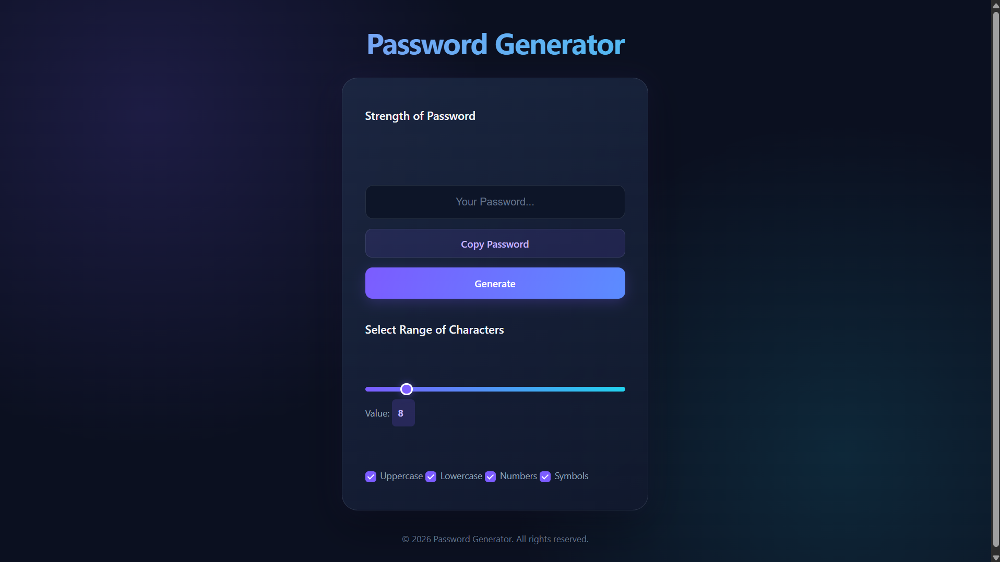
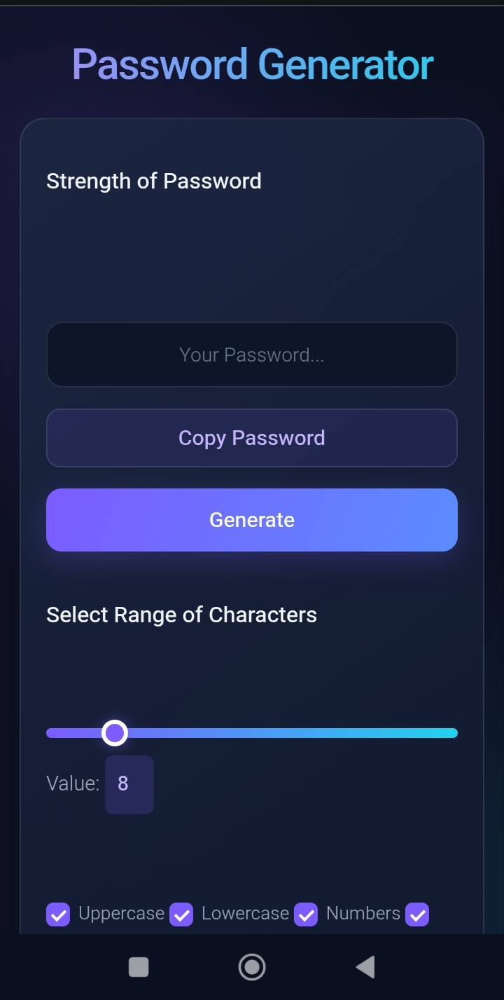
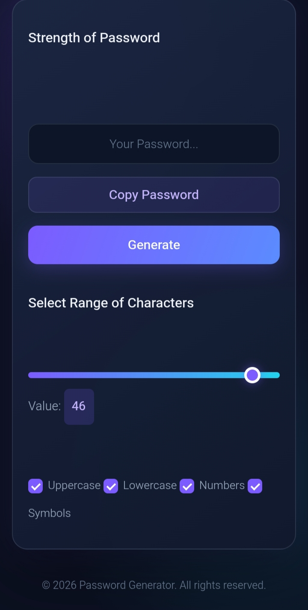

# 🔐 Password Generator

A modern, responsive **Password Generator Web Application** built using **Python, Django, HTML, CSS, and JavaScript**.

This application allows users to generate strong and secure random passwords with customizable options. It features a clean user interface and is deployed on **Render**.

🌐 **Live Demo:** [Password Generator](https://password-generator-sr7u.onrender.com/)

## ✨ Features

- Generate random passwords instantly.
- Customize password length.
- Include uppercase letters (A–Z).
- Include lowercase letters (a–z).
- Include numbers (0–9).
- Include special characters (!@#$%).
- Copy generated passwords to clipboard.
- Modern and user-friendly interface.
- Responsive design for different screen sizes.
- Secure configuration using environment variables.
- Deployed and accessible online.

## 🛠️ Technologies Used

| Technology | Purpose |
|---|---|
| Python | Backend programming |
| Django | Web framework |
| HTML5 | Website structure |
| CSS3 | Styling and responsive layout |
| JavaScript | Frontend interactivity |
| Gunicorn | Production WSGI server |
| WhiteNoise | Static file serving |
| Render | Cloud hosting |
| Git & GitHub | Version control and source code hosting |

## 📁 Project Structure

```text
Password-Generator/
├── generate/
│   ├── migrations/
│   │   └── __init__.py
│   ├── __init__.py
│   ├── admin.py
│   ├── apps.py
│   ├── models.py
│   ├── tests.py
│   ├── urls.py
│   └── views.py
├── passwordGenerator/
│   ├── __init__.py
│   ├── asgi.py
│   ├── settings.py
│   ├── urls.py
│   └── wsgi.py
├── screenshots/
│   ├── homepage.png
│   ├── mobile-1.jpeg
│   └── mobile-2.jpeg
├── static/
│   ├── css/
│   │   └── style.css
│   └── js/
│       └── scripts.js
├── staticfiles/             # Generated by collectstatic
│   ├── admin/
│   │   ├── css/
│   │   ├── img/
│   │   └── js/
│   ├── css/
│   └── staticfiles.json
├── templates/
│   └── base.html
├── .gitignore
├── build.sh
├── LICENSE
├── manage.py
├── README.md
└── requirements.txt
```

## ⚙️ Installation and Setup

Follow these steps to run the project locally.

### 1. Clone the Repository

```bash
git clone https://github.com/msaini45954-png/Password-Generator.git
```

### 2. Navigate to the Project Directory

```bash
cd Password-Generator
```

### 3. Create a Virtual Environment

```bash
python -m venv venv
```

### 4. Activate Virtual Environment

**Windows:**

```bash
venv\Scripts\activate
```

### 5. Install Dependencies

```bash
pip install -r requirements.txt
```

### 6. Run the Development Server

```bash
python manage.py runserver
```

### 7. Open in Browser

Visit:

```text
http://127.0.0.1:8000/
```

## 🚀 Deployment

This project is deployed using **Render**.

To deploy your own version:

1. Push your project to GitHub.
2. Create a new Web Service on [Render](https://render.com/).
3. Connect your GitHub repository.
4. Select the `main` branch.
5. Configure the following settings:

| Setting | Value |
|---|---|
| Runtime | Python 3 |
| Build Command | `bash build.sh` |
| Start Command | `gunicorn passwordGenerator.wsgi:application` |

### Environment Variables

Configure the following environment variables in Render:

| Variable | Value |
|---|---|
| `SECRET_KEY` | Your Django secret key |
| `DEBUG` | `False` |

**Important:** Keep your Django secret key private. Never upload it to GitHub.

## 🗄️ Database

This project does not require a database. Passwords are generated dynamically without storing user-generated passwords in a database.

## 📸 Screenshots
<!-- Add your screenshot path below -->
### Desktop View

<p align="center">
  
</p>

### Mobile View

<p align="center">
  
  
</p>
<!--  -->

## 🎯 Learning Outcomes

Through this project, I improved my understanding of:

- Python and Django fundamentals.
- Django project and application structure.
- Frontend and backend integration.
- HTML, CSS, and JavaScript.
- Responsive web design.
- Managing project dependencies using `requirements.txt`.
- Environment variables and deployment configuration.
- Deploying Django applications using Render.
- Using Git and GitHub for version control.

## 📄 License

This project is licensed under the MIT License. See the [LICENSE](LICENSE) file for details.

## 👨‍💻 Author

**Mohit Saini**

- GitHub: [msaini45954-png](https://github.com/msaini45954-png)
- LinkedIn: [Mohit Saini](https://www.linkedin.com/in/mohit-saini-a11804367/)

---

⭐ If you find this project useful, consider giving it a star!
